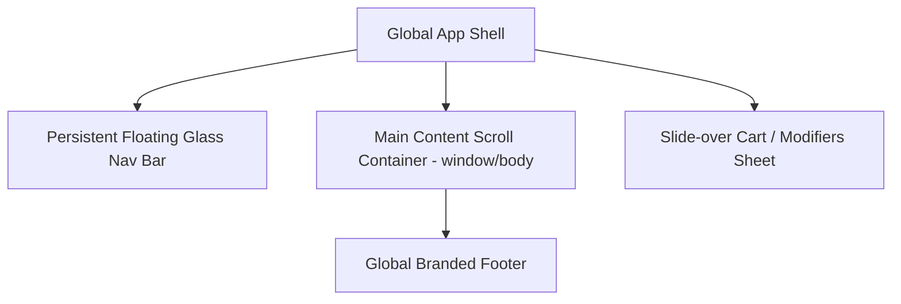

# App-Shell, Navigation & Async State Contract

**Document ID:** FF-SHELL-001  
**Version:** 1.1  
**Date:** 2026-10-04  
**Status:** BASELINED & AUDITED  

---

## 1. App-Shell & Scroll Ownership Contract

For dense, high-conversion restaurant applications, scroll ownership must be strictly defined to prevent scroll traps, jitter, and layout instability.

### Scroll Hierarchy Rules
1. **Root Window Ownership:** The primary `window` owns vertical scrolling for all standard routes (`/`, `/menu`, `/about`, `/locations`, `/checkout`). Nested scrollable containers on the main page are strictly prohibited.
2. **Persistent Floating Navigation Bar:**
   - Desktop: Fixed overlay bar (`position: fixed; top: 16px; left: 50%; transform: translateX(-50%)`). Starts with transparent background over the hero, smoothly transitions to `glass-surface` with backdrop blur after scrolling 60px down.
   - Mobile: Fixed top bar with logo, compact cart button with badge, and hamburger drawer toggle.
3. **Modal & Drawer Scroll Lock:**
   - When the Cart Drawer or Product Customization sheet opens, the root document body is locked (`overflow: hidden; touch-action: none;`). The drawer internal container independently owns vertical scrolling.
4. **Desktop Sticky Order Summary:**
   - On `/checkout`, the two-column grid assigns form fields to the left (scrolling naturally) and the authoritative Order Summary to the right (`position: sticky; top: 96px`). It remains visible throughout the checkout sequence.

---

## 2. Modal & Drawer Keyboard Accessibility & Focus Traps

All modal dialogs (Product Customizer, Confirmations) and slide-over drawers (Cart, Mobile Nav) strictly adhere to WAI-ARIA Dialog (Modal) Patterns:

1. **Focus Trap:**
   - When opened, focus is immediately directed to the primary interactive element (e.g. the first modifier option or close button).
   - Pressing `Tab` or `Shift+Tab` cycles focus strictly within the modal/drawer container. Focus cannot escape to the background document.
2. **Keyboard Dismissal:**
   - Pressing `Escape` immediately closes the open drawer or modal.
3. **Focus Restoration:**
   - Upon closing, focus is programmatically restored to the trigger element that initiated the interaction (e.g. the specific Product Card "Add" button or header Cart icon).
4. **ARIA Attributes:**
   - Containers declare `role="dialog"` (or `role="alertdialog"` for destructive confirmations) and `aria-modal="true"`.
   - Modals are labelled via `aria-labelledby="[modal-title-id]"` and described via `aria-describedby="[modal-desc-id]"`.

---

## 3. Screen Reader Live Regions & Announcement Policy

Dynamic state mutations and asynchronous errors must be announced to assistive technologies without visual disruption:

1. **Polite Announcer (`aria-live="polite"`, `role="status"`):**
   - Cart Quantity & Price Updates: Announce when an item is added, quantity changed, or coupon applied.
     - *Example:* `"Added 1 Double Truffle Burger to your cart. Cart subtotal is now $14.99."`
     - *Example:* `"Coupon WELCOME10 applied. $2.50 discount reflected."`
2. **Assertive Announcer (`aria-live="assertive"`, `role="alert"`):**
   - Critical Async Validation Blockers & Outages:
     - *Example:* `"Alert: Item Double Truffle Burger has sold out. Please remove it from your cart to complete checkout."`
     - *Example:* `"Alert: Your delivery address is outside our current branch service zone."`
     - *Example:* `"Alert: Branch closed at 10:00 PM. Checkout halted."`

---

## 4. Async State Contract & Skeletons

Every asynchronous route, modal, and interactive section enforces the explicit loading state lifecycle:
$$\text{Instant Shell} \to \text{Skeleton / Dimension Reservation} \to \text{Hydrated Content} \to \text{Error / Empty State}$$

### Layout Stability (CLS $\le 0.1$)
- Blank screens and layout jumps are forbidden.
- Skeletons must exactly match the rendered dimensions (width, height, aspect ratio) of product cards, category chips, and summary rows.
- Skeletons use subtle shimmer animation on `--surface-dark` without jarring white pulses.

### State Transitions by Route

| Route / Section | Instant Shell Component | Skeleton Placeholder | Active Content | Error / Recovery |
|---|---|---|---|---|
| **Storefront Menu** | Top nav bar + category rail skeleton | 6-card shimmer grid with 4:3 image placeholders | Product cards with lazy WebP images | "Failed to load menu" alert with "Retry" button |
| **Product Customizer** | Modal backdrop with pre-filled title | Modifier group shimmer radio list | Dynamic options with real-time price | Inline error alert if group fetch fails |
| **Cart Drawer** | Glass drawer frame with header | Item row skeletons with quantity counter | Item list with subtotal and coupon field | Cart calculation error banner |
| **Order Tracking** | Timeline frame with order number | Pulse node on active status step | Live timeline and estimated time | Quiet fallback to 10s polling banner |

---

## 5. Responsive Breakpoint Model

| Breakpoint Name | Viewport Width | Navigation Layout | Menu Grid Layout | Customizer Surface |
|---|---|---|---|---|
| **Small Mobile** | 360px – 480px | Compact top bar | 1 column full width | Bottom sheet |
| **Large Mobile** | 481px – 767px | Compact top bar | 2 column compact | Bottom sheet |
| **Tablet** | 768px – 1023px | Glass pill overlay | 2–3 columns | Floating centered modal |
| **Laptop / Desktop** | 1024px – 1439px| Full floating glass nav | 3–4 columns | Side-by-side modal |
| **Large Desktop** | $\ge 1440px$ | Centered max-width nav | 4 columns (max 1400px container) | Large editorial modal |
