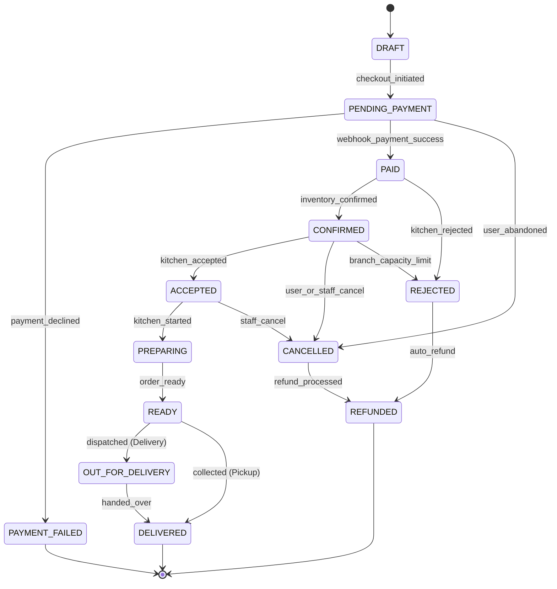

# Behavior Models & Workflow State Machines

**Document ID:** FF-BEH-001  
**Version:** 1.1  
**Date:** 2026-10-04  
**Status:** BASELINED & FORMALLY VERIFIED  

---

## 1. Order Lifecycle State Machine

### Order Transition Specification Table

| Current State | Event / Trigger | Guard / Precondition | Target State | Side Effects | Invariants |
|---|---|---|---|---|---|
| `DRAFT` | `checkout_initiated` | Cart valid, items available, zone serviceable. | `PENDING_PAYMENT` | Recalculate totals; insert row into `orders`; emit `order.created` to outbox. | Client totals ignored; authoritative total locked in `orders.total_minor`. |
| `PENDING_PAYMENT` | `webhook_payment_success` | Provider signature valid; amount matches `total_minor`. | `PAID` | Deduplicate event; record payment; emit `payment.succeeded`. | Order cannot become `PAID` without verified payment payload. |
| `PENDING_PAYMENT` | `payment_declined` | Provider error received or timeout. | `PAYMENT_FAILED` | Record failure code in `payments`; notify client. | Order status remains terminal unless restarted with new intent. |
| `PAID` | `system_confirm` | Automatic kitchen capacity check passes. | `CONFIRMED` | Emit `order.confirmed`; queue in staff/kitchen dashboard. | Monotonic forward progress. |
| `CONFIRMED` | `kitchen_accepted` | Kitchen operator clicks Accept. | `ACCEPTED` | Emit `order.status_changed`; update tracking timeline. | State change auditable with actor ID in `order_status_history`. |
| `ACCEPTED` | `kitchen_started` | Food preparation begins. | `PREPARING` | Emit `order.status_changed`; notify customer via SSE. | Customer cannot cancel order once preparing. |
| `PREPARING` | `order_ready` | Kitchen marks order ready. | `READY` | Emit `order.status_changed`; notify driver or pickup customer. | Kitchen SLA timer stops. |
| `READY` | `dispatch` | Driver assigned & departs (Delivery mode). | `OUT_FOR_DELIVERY` | Emit `order.status_changed`; live tracking map active. | Driver assigned; delivery address locked. |
| `READY` / `OUT_FOR_DELIVERY` | `handover` | Delivery completed or pickup collected. | `DELIVERED` | Emit `order.status_changed`; complete order. | Terminal success state. Order lines immutable. |
| `CONFIRMED` / `PAID` | `kitchen_reject` | Kitchen out of ingredients or branch emergency. | `REJECTED` | Reason required in `order_status_history`; triggers refund workflow. | Mandatory non-empty reason string. |
| `REJECTED` | `refund_processed` | Payment provider refund API returns success. | `REFUNDED` | Emit `payment.refunded`; notify customer via email/SMS. | Terminal state. Total refunded equals amount charged. |

---

## 2. Payment Lifecycle State Machine

| Current State | Event / Trigger | Guard / Precondition | Target State | Side Effects | Invariants |
|---|---|---|---|---|---|
| `NONE` | `create_intent` | Order in `PENDING_PAYMENT`; valid `Idempotency-Key`. | `INTENT_CREATED` | Create provider intent; save intent ID in `payments`. | Amount matches `orders.total_minor`. |
| `INTENT_CREATED` | `customer_submits` | Card details accepted by provider hosted fields. | `PROCESSING` | Record transition in `payments`. | Card data never touches application backend. |
| `PROCESSING` | `webhook_success` | Valid provider cryptographic signature; unique event ID. | `SUCCEEDED` | Deduplicate event in `payment_events`; transition Order to `PAID`. | At-most-once execution via unique `(provider, provider_event_id)`. |
| `PROCESSING` | `webhook_failure` | Provider returns card error / fraud decline. | `FAILED` | Save failure code in `payments`; transition Order to `PAYMENT_FAILED`. | Prevents fulfillment without settlement. |
| `SUCCEEDED` | `issue_refund` | Order in `REJECTED` or `CANCELLED`; caller authorized. | `REFUNDED` | Call provider refund API; update payment record; emit event. | Refund amount $\le$ original payment amount. |

---

## 3. Delivery Qualification Workflow

| Current State | Event / Trigger | Guard / Precondition | Target State | Side Effects | Invariants |
|---|---|---|---|---|---|
| `UNVERIFIED` | `submit_address` | Latitude and longitude parsed; street string non-empty. | `VALIDATING` | Invoke geocoding normalization and zone polygon check. | Address inputs sanitized. |
| `VALIDATING` | `zone_match_found` | Coordinates fall inside active `delivery_zones.polygon_geojson`. | `SERVICEABLE` | Compute distance; calculate `delivery_fee_minor`; lock quote for 15 mins. | Delivery fee computed server-side from zone base fee + per-km rate. |
| `VALIDATING` | `out_of_bounds` | Coordinates outside all branch active delivery zones. | `UNSERVICEABLE` | Return `DELIVERY_NOT_SERVICEABLE` error code; offer Pickup alternative. | Delivery cannot proceed for unserviceable addresses. |
| `VALIDATING` | `branch_closed` | Matched branch has `accepts_delivery = false` or outside hours. | `UNSERVICEABLE` | Return `BRANCH_CLOSED` error code; display next opening time. | Operating hours checked against branch local timezone. |

---

## 4. Coupon Application & Redemption Workflow

| Current State | Event / Trigger | Guard / Precondition | Target State | Side Effects | Invariants |
|---|---|---|---|---|---|
| `UNAPPLIED` | `apply_code` | Code exists in `promotions`; current time $\in [\text{starts\_at}, \text{ends\_at}]$. | `APPLIED_IN_CART` | Validate cart subtotal $\ge$ minimum order; calculate estimated discount. | Discount cannot exceed subtotal. |
| `APPLIED_IN_CART` | `remove_code` | User removes code or modifies cart below minimum order. | `UNAPPLIED` | Recalculate cart totals without discount. | Total reverts to standard sum. |
| `APPLIED_IN_CART` | `checkout_commit` | `total_redemptions < usage_limit_total` AND `user_redemptions < usage_limit_per_user`. | `REDEEMED` | Insert row into `coupon_redemptions` within order transaction; lock discount. | Unique constraint on `unique_key`; atomic increment inside ACID transaction. |
| `APPLIED_IN_CART` | `limit_exceeded` | Concurrency check reveals promo limit reached during checkout. | `REJECTED_AT_CHECKOUT`| Abort place-order transaction; notify user `COUPON_LIMIT_EXCEEDED`. | Prevents coupon over-redemption under race conditions. |

---

## 5. Cart Item Lifecycle

| Current State | Event / Trigger | Guard / Precondition | Target State | Side Effects | Invariants |
|---|---|---|---|---|---|
| `EMPTY` | `add_item` | Menu item is active and available at branch. | `CONFIGURING` | Open modifier selector sheet. | Item availability verified against branch menu overrides. |
| `CONFIGURING` | `select_modifiers`| Selections satisfy group `min_selections` and `max_selections`. | `VALIDATED` | Compute item line total $= (\text{base\_price} + \sum \Delta) \times q$. | Negative modifier deltas prohibited. Quantity $\in [1, 99]$. |
| `VALIDATED` | `add_to_cart` | Modifiers valid; quantity $\ge 1$. | `IN_CART` | Add to cart collection grouped by item ID + modifier hash. | Cart subtotal dynamically updated. |
| `IN_CART` | `stock_depleted` | Item becomes inactive or branch closes prior to checkout. | `OUT_OF_STOCK` | Flag item in cart UI with red badge; disable checkout CTA. | Checkout cannot proceed while any item in cart is `OUT_OF_STOCK`. |
| `IN_CART` | `order_placed` | Place-order transaction commits. | `COMMITTED` | Write immutable line item snapshots to `order_items`; clear cart session. | Historical snapshots decouple line items from future catalog updates. |
