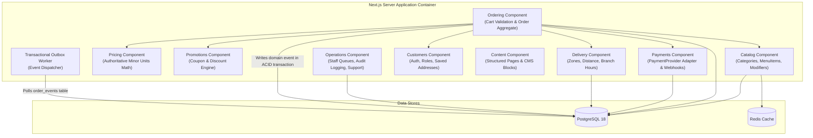
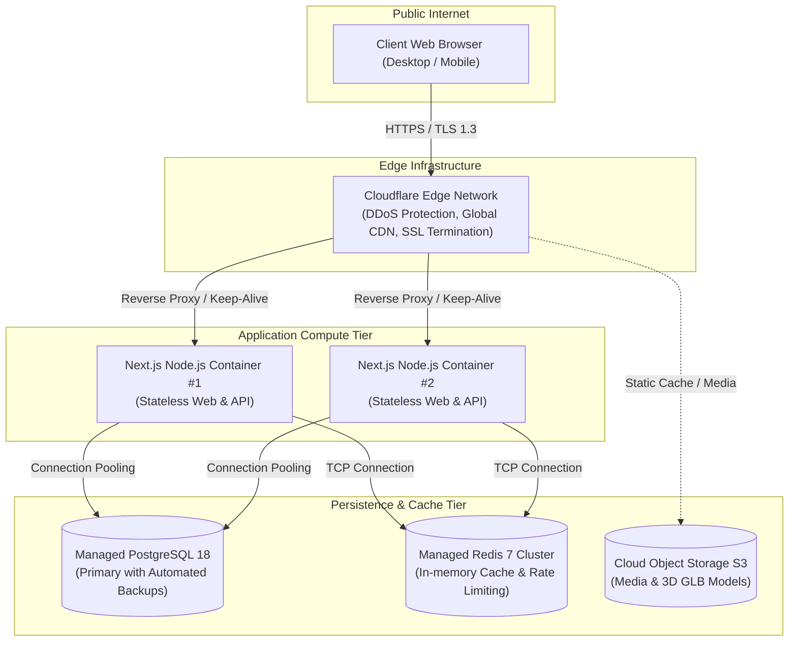

# C4 Architecture Model — Premium Fast-Food Restaurant

**Document ID:** FF-C4-001  
**Version:** 1.0  
**Date:** 2026-10-04  
**Status:** BASELINED  

---

## Level 1: System Context Diagram

```mermaid
flowchart TD
    Customer["Customer (Guest / Authenticated)"]
    Staff["Branch Staff"]
    Kitchen["Kitchen Operator"]
    Admin["Restaurant Admin / Manager"]
    
    Monolith["Premium Fast-Food Monolith\n(Next.js 16 + Node.js)"]
    
    PaymentGateway["Payment Provider\n(Hosted Checkout / Webhooks)"]
    CDN["Edge CDN + WAF\n(Cloudflare)"]
    MapsProvider["Maps / Geocoding Service\n(Address Verification)"]
    MessagingProvider["Messaging Service\n(SMS / Email Notifications)"]
    
    Customer -->|Visits & Orders [HTTPS]| CDN
    CDN -->|Forwards to origin [HTTPS]| Monolith
    Staff -->|Manages orders [HTTPS]| Monolith
    Kitchen -->|Manages prep queue [HTTPS]| Monolith
    Admin -->|Administers catalog & branches [HTTPS]| Monolith
    
    Monolith -->|Creates payment intents & verifies webhooks [HTTPS]| PaymentGateway
    Monolith -->|Geocodes delivery addresses [HTTPS]| MapsProvider
    Monolith -->|Dispatches transactional alerts [HTTPS]| MessagingProvider
```

---

## Level 2: Container Diagram

```mermaid
flowchart TD
    subgraph ClientLayer ["Client Devices"]
        Browser["Browser Web App\n(React 19, Tailwind, GSAP, R3F)"]
    end

    subgraph OriginInfrastructure ["Application & Persistence Infrastructure"]
        CDN_WAF["Cloudflare CDN & Edge WAF"]
        
        NextServer["Next.js Application Server\n(App Router, Route Handlers, RSC)"]
        
        Postgres[("PostgreSQL 18 Database\n(Normalized System of Record)")]
        RedisStore[("Redis\n(Cache & Distributed Locks)")]
        ObjectStorage[("S3 Object Storage / Image CDN\n(Food Media & 3D Assets)")]
    end

    subgraph ExternalServices ["External Providers"]
        StripeGateway["Payment Provider (Stripe)"]
        GeocodeAPI["Maps / Geocoding API"]
        EmailSMS["Email & SMS Provider"]
    end

    Browser -->|HTTPS / JSON| CDN_WAF
    CDN_WAF -->|Dynamic Requests| NextServer
    CDN_WAF -->|Cached Media / Static Assets| ObjectStorage

    NextServer -->|Drizzle ORM / SQL| Postgres
    NextServer -->|Key-Value / TCP| RedisStore
    NextServer -->|Media Uploads / S3 API| ObjectStorage

    NextServer -->|Payment Intents / REST| StripeGateway
    StripeGateway -->|Asynchronous Webhooks [HTTPS]| NextServer
    NextServer -->|Geocoding / REST| GeocodeAPI
    NextServer -->|Notification Triggers / REST| EmailSMS
```

---

## Level 3: Component Diagram (Next.js Application Container)



---

## Level 4: Deployment Diagram


