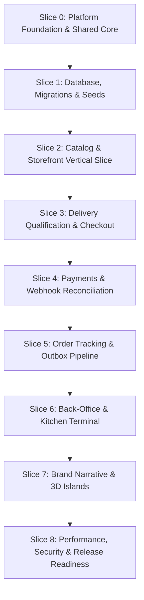

# Delivery Plan — Vertical Slice Implementation Roadmap

**Document ID:** FF-DELIV-001  
**Version:** 1.0  
**Date:** 2026-10-04  
**Status:** BASELINED  
**Delivery Strategy:** Incremental Vertical Slices with Continuous Specialist QA Waves  

---

## 1. Delivery Architecture & Dependency Order

The implementation is structured into 9 vertical slices executed in dependency order. In accordance with Website Factory v7.4.0, once this Delivery Plan receives human approval, implementation proceeds continuously without stopping for individual slice approvals.

---

## 2. Implementation Slices Specification

### Slice 0: Foundation, Toolchain & Design Tokens
- **Scope:** Next.js 16.x App Router repository initialization, TypeScript 5 strict mode, Tailwind CSS configuration with design system tokens (`--ink`, `--surface-glass`, `--accent-red`, `--accent-orange`), base layout shell with floating nav bar.
- **Dependencies:** None.
- **Definition of Done:** Next.js build passes, TypeScript compiles cleanly, toolchain scripts verified.

### Slice 1: Database Schema, Migrations & Deterministic Seed Data
- **Scope:** PostgreSQL 18 schema setup with Drizzle ORM. 22 tables mapped: `users`, `branches`, `branch_hours`, `delivery_zones`, `categories`, `menu_items`, `modifier_groups`, `modifier_options`, `orders`, `order_items`, `payments`, `order_events` (outbox), and `audit_logs`. Deterministic seeding of 5 categories, 20 menu items, 3 branches, and sample promo codes.
- **Dependencies:** Slice 0.
- **Definition of Done:** Migrations apply cleanly; seed script is idempotent; foreign keys and unique constraints verified.

### Slice 2: Catalog & Storefront Vertical Slice
- **Scope:** Food-first home route (`/`), category navigation chips, product cards with image, badge, price, and add button. Interactive Product Customizer modal/bottom-sheet enforcing modifier selection rules. Slide-over Cart Drawer with item grouping, quantity steppers, and authoritative total previews.
- **Dependencies:** Slice 1.
- **Definition of Done:** User can browse categories, customize an item, add to cart, and see dynamic subtotal updates.

### Slice 3: Delivery Qualification & Idempotent Checkout
- **Scope:** Checkout funnel (`/checkout`): Service Mode (Delivery / Pickup), branch selection, address input with zone polygon check and distance calculation. Authoritative server calculation of subtotal, delivery fee, taxes, and coupon discounts. Idempotent order placement (`POST /api/v1/orders`) creating order in `PENDING_PAYMENT` with locked totals and outbox event `order.created`.
- **Dependencies:** Slice 2.
- **Definition of Done:** End-to-end checkout creates order row and snapshots in database; duplicate submissions return existing order; out-of-zone addresses gracefully rejected.

### Slice 4: Payment Provider Adapter & Webhook Reconciliation
- **Scope:** Abstracted `PaymentProvider` interface. Implementation of hosted payment flow (e.g. Stripe Elements/Checkout). Route handlers for `POST /api/v1/payments/intents` and `POST /api/v1/payments/webhooks/:provider`. Cryptographic signature verification and deduplication in `payment_events(provider, provider_event_id)` transitioning order to `PAID`.
- **Dependencies:** Slice 3.
- **Definition of Done:** Test payment completes; webhook idempotency verified with duplicate payloads; order transitions to `PAID`.

### Slice 5: Order Status State Machine & Live Tracking
- **Scope:** State transition service (`PAID -> CONFIRMED -> ACCEPTED -> PREPARING -> READY -> OUT_FOR_DELIVERY -> DELIVERED`). Live tracking route (`/orders/[id]/track`) with SSE stream (`/api/v1/orders/:id/events`) and automatic 10-second polling fallback. High-entropy token access for guests.
- **Dependencies:** Slice 4.
- **Definition of Done:** Real-time status updates reflect immediately in browser timeline; guest tokens prevent unauthorized access.

### Slice 6: Back-Office Operations & Kitchen Display
- **Scope:** Admin layout (`/admin`), incoming orders queue, Kitchen Preparation Terminal (`/admin/kitchen`) with fast status toggles (`Accept`, `Start Prep`, `Ready`), branch hours/exception toggles, and immutable `audit_logs` viewer.
- **Dependencies:** Slice 5.
- **Definition of Done:** Kitchen operator advances order status; audit log records all administrative mutations.

### Slice 7: Brand Narrative & 3D Narrative Islands
- **Scope:** Cinematic About page (`/about`) with GSAP ScrollTrigger pinned timeline. Lazy-loaded Three.js / React Three Fiber culinary model with `frameloop="demand"`. Responsive fallback to high-resolution photography under `prefers-reduced-motion` and mobile low-power modes.
- **Dependencies:** Slice 6.
- **Definition of Done:** Scroll animation runs smoothly without blocking commerce; LCP is a static WebP image; GPU memory disposed cleanly on unmount.

### Slice 8: Performance Hardening & Security Verification
- **Scope:** Bundle optimization ($\le 250$ KB initial JS), Core Web Vitals lab verification (LCP $\le 2.5$s, INP $\le 200$ms, CLS $\le 0.1$), automated security suite (BOLA, price tampering, CSRF headers, rate limiting), and WCAG 2.2 AA accessibility audit.
- **Dependencies:** Slice 7.
- **Definition of Done:** All quality rings A through H pass with green evidence.

---

## 3. Continuous Specialist Verification Waves

After each slice batch, the continuous test orchestrator executes specialist verification lanes in parallel:
- **Lane A:** Static typing (`tsc --noEmit`), ESLint, and schema tests.
- **Lane B:** Unit domain business rules (pricing, modifier bounds, coupons).
- **Lane C:** Database integration and transaction rollback tests.
- **Lane D:** Playwright E2E customer and staff browser journeys.
- **Lane E:** Interaction audit (button states, navigation consistency, permission parity).
- **Lane F:** WCAG 2.2 AA accessibility checks via `@axe-core/playwright`.
- **Lane G:** Adversarial security tests (BOLA, price manipulation, webhook replay).
- **Lane H:** Performance budgets and Core Web Vitals.
