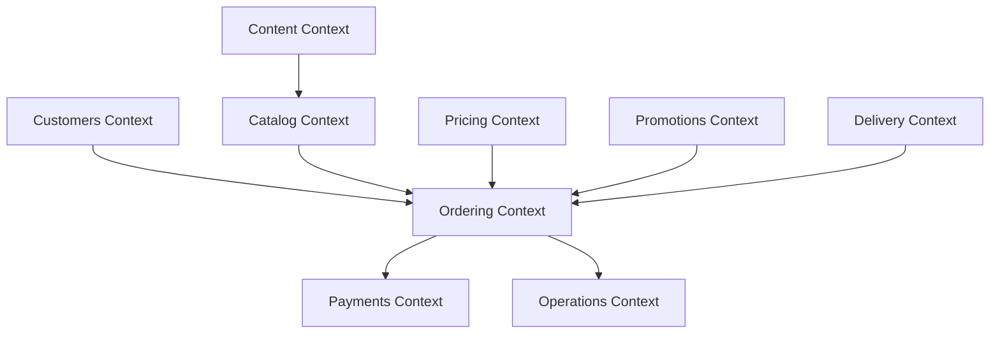

# Domain Model — Premium Fast-Food Restaurant

**Document ID:** FF-DOM-001  
**Version:** 1.0  
**Date:** 2026-10-04  
**Status:** BASELINED  

---

## 1. Bounded Contexts & Aggregate Roots

The domain architecture is organized into 9 bounded contexts within a modular monolith:

### 1. Catalog Context
- **Aggregate Root:** `MenuItem`, `Category`
- **Entities:** `ModifierGroup`, `ModifierOption`, `MenuItemMedia`, `BranchMenuItem`
- **Value Objects:** `SKU`, `DietaryTag`, `AllergenInfo`, `Slug`
- **Invariants:**
  - Base price is an integer in minor currency units (cents).
  - Modifiers cannot have negative price deltas.
  - Category sort order defines visual scan sequence on storefront.
- **Domain Events:** `menu.updated`, `category.updated`, `item.out_of_stock`

### 2. Pricing Context
- **Aggregate Root:** `PricingSnapshot`
- **Entities:** `TaxRule`, `FeeStructure`
- **Value Objects:** `Money` (integer minor units + 3-char ISO currency), `PriceDelta`
- **Invariants:**
  - Total Formula: $\text{total\_minor} = \text{subtotal\_minor} - \text{discount\_minor} + \text{delivery\_fee\_minor} + \text{tax\_minor} + \text{service\_fee\_minor}$
  - Absolute server calculation authority; zero trust of client totals.
- **Domain Events:** `price.changed`

### 3. Promotions Context
- **Aggregate Root:** `Promotion`
- **Entities:** `Coupon`, `CouponRedemption`
- **Value Objects:** `DiscountBenefit` (percentage, fixed, BOGO), `UsageLimit`
- **Invariants:**
  - Total discount cannot exceed the cart subtotal.
  - Non-stackable unless explicitly flagged `stackable = true`.
  - Enforces per-user limit and global redemption limit inside order transaction.
- **Domain Events:** `promotion.redeemed`, `promotion.expired`

### 4. Ordering Context
- **Aggregate Root:** `Order`
- **Entities:** `OrderItem`, `OrderItemModifier`, `OrderStatusHistory`
- **Value Objects:** `OrderNumber` (human-readable), `IdempotencyKey` (UUIDv4), `ServiceMode` (`DELIVERY`, `PICKUP`, extensible `DINE_IN`)
- **Invariants:**
  - Order lines are immutable snapshots upon placement.
  - Requires valid `idempotency_key`.
  - Strict monotonic forward progression of order status.
- **Domain Events:** `order.created`, `order.paid`, `order.confirmed`, `order.status_changed`, `order.cancelled`, `order.rejected`

### 5. Delivery Context
- **Aggregate Root:** `Branch`, `DeliveryZone`
- **Entities:** `BranchHours`, `BranchException`
- **Value Objects:** `GeoJSONPolygon`, `Distance`, `DeliveryQuote`, `Coordinates`
- **Invariants:**
  - Branch delivery status controlled by `accepts_delivery` and operating hours.
  - Distance/polygon rules determine serviceability and delivery fee authoritatively.
- **Domain Events:** `branch.updated`, `delivery_zone.changed`

### 6. Payments Context
- **Aggregate Root:** `Payment`
- **Entities:** `PaymentEvent` (Provider Webhook Log)
- **Value Objects:** `ProviderPaymentId`, `ProviderEventId`, `PaymentIntent`
- **Invariants:**
  - Provider-agnostic adapter; PCI SAQ A compliance (zero PAN/CVV stored).
  - Deduplicated by `(provider, provider_event_id)` unique constraint.
- **Domain Events:** `payment.succeeded`, `payment.failed`, `payment.refunded`

### 7. Customers Context
- **Aggregate Root:** `User`
- **Entities:** `UserAddress`, `UserRole`, `Favorite`
- **Value Objects:** `EmailAddress`, `PhoneNumber`, `GuestTrackingToken` (UUIDv4)
- **Invariants:**
  - Passwords hashed with bcrypt/Argon2.
  - Guest orders receive unguessable tracking token.
- **Domain Events:** `customer.registered`, `address.added`

### 8. Content Context
- **Aggregate Root:** `ContentPage`
- **Entities:** `ContentBlock`
- **Value Objects:** `BlockType` (`hero`, `story_split`, `ingredient_story`, `timeline`, `gallery`, `3d_scene`, `quote`, `faq`), `SEOData`
- **Invariants:**
  - Blocks validated against strict JSON schemas; safe from unescaped HTML injections.
- **Domain Events:** `content.published`

### 9. Operations Context
- **Aggregate Root:** `AuditLog`, `SupportTicket`
- **Entities:** `StaffUser`
- **Value Objects:** `RequestId`, `IPHash`
- **Invariants:**
  - All admin mutations concurrently record an immutable audit log entry in the same transaction.
- **Domain Events:** `audit.recorded`, `ticket.submitted`

---

## 2. Immutable Historical Snapshots

To ensure past orders cannot be altered when menu prices or modifier options are updated:

### `order_items` Snapshot Schema
- `item_name_snapshot`: Captured verbatim product title at time of order.
- `unit_price_minor`: Captured base price in integer minor units.
- `quantity`: Positive integer ($1 \le q \le 99$).
- `line_total_minor`: $(\text{unit\_price\_minor} + \sum \text{modifier\_deltas}) \times \text{quantity}$.
- `notes`: Customer special request (sanitized, max 255 chars).

### `order_item_modifiers` Snapshot Schema
- `name_snapshot`: Captured modifier option label at time of order.
- `price_delta_minor`: Captured modifier upcharge in minor units ($\ge 0$).
- `quantity`: Number of units of this modifier (default 1).

### `orders.delivery_address_snapshot`
- JSONB object preserving the exact recipient name, phone, street address, city, postal code, and geocoordinates used for fulfillment.
