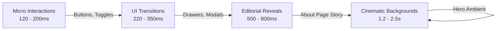

# Motion Contract & Reduced Motion Specification

**Document ID:** FF-MOT-001  
**Version:** 1.1  
**Date:** 2026-10-04  
**Status:** BASELINED & AUDITED  

---

## 1. Motion Principles

Motion serves a singular purpose: **augment comprehension, reinforce tactile responsiveness, and enhance brand delight without obstructing ordering speed.**

### Non-Negotiable Motion Invariants
1. **Never Block Commerce:** Animation must never delay an order action, cart update, or checkout transition.
2. **Intentional Over Decorative:** Blanket page fades and gratuitous bouncy entrance animations on commerce screens are prohibited.
3. **Strict Reduced Motion Compliance:** Every motion class has a deterministic disabled or simplified state.

---

## 2. Motion Classes & Durations



### Motion Tiers
- **Micro Interactions (120ms – 200ms):**
  - Easing: `cubic-bezier(0.2, 0.0, 0.0, 1.0)`
  - Use: Button hover states, checkbox toggles, quantity counter taps, cart badge bump.
- **UI Transitions (220ms – 350ms):**
  - Easing: `cubic-bezier(0.16, 1, 0.3, 1)`
  - Use: Cart slide-over drawer entrance, product modal scale-up, dropdown menu expands.
- **Editorial Reveals (500ms – 800ms):**
  - Easing: `cubic-bezier(0.25, 1, 0.5, 1)`
  - Use: About page headline reveals, ingredient card parallax, timeline section pins.
- **Cinematic Ambient (1.2s – 2.5s):**
  - Easing: Linear or subtle sinusoidal ease-in-out.
  - Use: Ambient background smoke/particle drift on hero sections (purely aesthetic).

---

## 3. 3D Narrative Island & ScrollTrigger Contract

### GSAP ScrollTrigger Usage (About Page)
- Scrubbed and pinned timelines are strictly limited to the About page narrative sequence (`/about`).
- Animation timelines must decouple layout from GPU rendering; pins use CSS transforms and will not trigger document reflows.

### Three.js / React Three Fiber Performance Rules
- **On-Demand Rendering:** The 3D canvas uses `frameloop="demand"`, re-rendering frames only when user scrolls or drags. Continuous 60fps loops without user interaction are prohibited.
- **GPU Resource Cleanup:** All geometries and textures must be disposed in React `useEffect` cleanup handlers (`geometry.dispose()`, `material.dispose()`).
- **LCP Protection:** The 3D canvas is unmounted on initial load; an optimized static WebP poster serves as the immediate LCP asset.

---

## 4. Reduced Motion Contract (`prefers-reduced-motion: reduce`)

When the user requests reduced motion at the OS or browser level:
1. **Camera Motion & Parallax:** Completely disabled. ScrollTrigger scrub animations become static sequential layouts.
2. **3D Models:** The 3D WebGL canvas is unmounted. Replaced by high-resolution still food photography.
3. **UI Transitions:** Drawer and modal slide animations become instantaneous or a subtle 100ms opacity fade.
4. **Accessible Glassmorphism Solid Fallback Enforcement:**
   When `backdrop-filter` is disabled under reduced motion, the translucent background without blur can fail WCAG contrast against complex background food images. Therefore, reduced motion strictly enforces a **100% opaque solid background** (`var(--surface-dark)`):
   ```css
   @media (prefers-reduced-motion: reduce) {
     *, ::before, ::after {
       animation-duration: 0.01ms !important;
       animation-iteration-count: 1 !important;
       transition-duration: 0.01ms !important;
       scroll-behavior: auto !important;
     }

     /* Enforces solid opaque background to maintain >= 4.5:1 text contrast */
     .glass-surface, .glass-panel {
       backdrop-filter: none !important;
       -webkit-backdrop-filter: none !important;
       background: var(--surface-dark) !important;
       border: 1px solid rgba(255, 255, 255, 0.16) !important;
     }
   }
   ```
