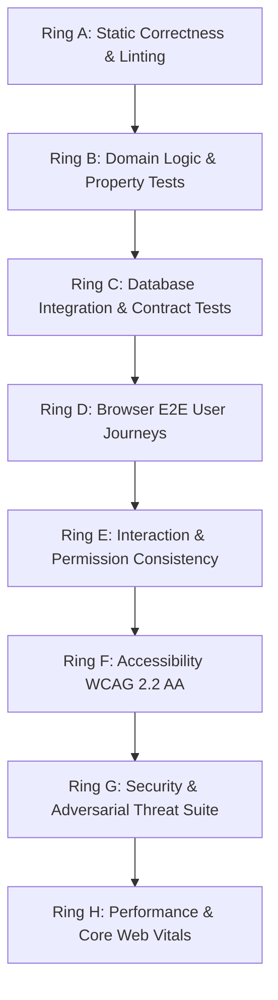

# Quality Model & Verification Standards

**Document ID:** FF-QUAL-001  
**Version:** 1.0  
**Date:** 2026-10-04  
**Status:** BASELINED  

---

## 1. Quality Rings & Verification Lanes

In accordance with Website Factory quality engineering, system validation is structured into 8 concentric verification rings:

### Ring A — Static Correctness
- TypeScript 5 strict mode (`tsc --noEmit`).
- ESLint + Prettier formatting.
- Zod schema validation over all API request and response boundaries.

### Ring B — Domain & Property Tests
- Unit testing pure business rules: pricing calculations, modifier bounds, promotion evaluation, delivery fee calculation, and order state transition validity.
- Invariant tests: mathematically impossible for total to be negative; discount never exceeds subtotal.

### Ring C — Contract & Integration Tests
- Real PostgreSQL 18 test database executing actual Drizzle ORM migrations.
- Place-order ACID transaction tests (verifying rollback if modifier invalid).
- Webhook deduplication tests (verifying identical webhook delivers at-most-once state change).
- Transactional outbox persistence tests.

### Ring D — Full Browser Journeys
- Playwright E2E browser tests:
  - Guest customer: arrival $\to$ category filter $\to$ customize item $\to$ add to cart $\to$ checkout $\to$ mock payment $\to$ order tracking.
  - Returning customer: login $\to$ saved address selection $\to$ reorder.
  - Kitchen operator: order appears in queue $\to$ accept $\to$ mark ready.

### Ring E — Interaction & Permission Consistency Audit
- Parity rule: controls hidden from unauthorized roles; direct API requests independently rejected by server-side RBAC.
- High-impact confirmation dialog tests: verifying cancellation and destructive actions require explicit modal confirmation.

### Ring F — Accessibility (WCAG 2.2 AA)
- Automated testing via `@axe-core/playwright`.
- Focus visibility: $\ge 3:1$ contrast outline on glass surfaces.
- Reduced motion test: `prefers-reduced-motion` triggers static image fallback; disables 3D canvas and scroll scrub.

### Ring G — Security Verification
- OWASP Top 10:2025 and API Top 10:2023 verification.
- BOLA / IDOR negative tests: customer cannot fetch another customer's order.
- Price tampering test: client-submitted totals ignored; server calculates totals.
- Injection tests: special instructions sanitized.

### Ring H — Performance & Scale
- Core Web Vitals on mobile and desktop: LCP $\le$ 2.5s, INP $\le$ 200ms, CLS $\le$ 0.1.
- Initial JavaScript bundle $\le$ 250 KB compressed.
- Three.js / R3F dynamic chunking and GPU memory cleanup verification.
