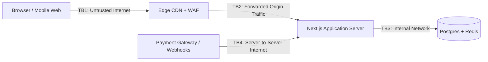

# System Threat Model — Premium Fast-Food Restaurant

**Document ID:** FF-THREAT-001  
**Version:** 1.1  
**Date:** 2026-10-04  
**Status:** BASELINED & AUDITED  
**Frameworks:** STRIDE, OWASP Top 10 (2025), OWASP API Top 10 (2023)  

---

## 1. System Architecture & Trust Boundaries



- **TB1: Untrusted Browser Client $\leftrightarrow$ Edge CDN:** Public internet traffic. Risks: DDoS, volumetric scraping, brute force, parameter tampering, XSS.
- **TB2: Edge CDN $\leftrightarrow$ Next.js Application Server:** Origin connection. Risks: Bypass of edge WAF, header spoofing, host header injection.
- **TB3: Application Server $\leftrightarrow$ PostgreSQL Database & Redis Cache:** Internal persistence tier. Risks: SQL injection, privilege escalation, unauthorized cross-tenant queries.
- **TB4: Application Server $\leftrightarrow$ Third-Party Payment Gateway:** External webhooks and intents. Risks: Fake webhook spoofing, replay attacks, MitM.

---

## 2. STRIDE Threat Analysis & Concrete Mitigations

| Threat Category | Threat Scenario & Abuse Case | Applicable Boundary | Engineered Mitigation & Verification |
|---|---|---|---|
| **Spoofing** | Attacker crafts fake payment webhook to falsely mark an order as `PAID`. | TB4 | Cryptographic signature verification using provider shared webhook secret (e.g. `stripe.webhooks.constructEvent`). Reject unverified signatures with 400. |
| **Tampering** | Client intercepts checkout request and alters item price or injects negative modifier price delta. | TB1, TB2 | **Zero-trust server pricing.** Server recalculates entire cart total from database prices and verified modifier options. Client-submitted prices are completely ignored. |
| **Repudiation** | Operator or customer disputes an order status change or administrative price modification. | TB3 | Immutable `audit_logs` record created within the same ACID transaction for all admin actions. Customer status changes tracked in `order_status_history`. |
| **Information Disclosure (BOLA / IDOR)** | Attacker enumerates sequential order IDs (`/api/v1/orders/101`) to view other customers' PII and addresses. | TB1, TB2 | High-entropy UUIDv4 identifiers. Strict server-side verification: `order.user_id == session.user.id` for customers, or cryptographically random tracking token for guests. |
| **Denial of Service (DoS & TOCTOU)** | Attacker fires 50 concurrent requests in the same millisecond to redeem a single-use coupon 50 times. | TB1, TB3 | Database transaction with `SELECT ... FOR UPDATE` or optimistic locking on `coupon_redemptions`. Unique constraint on redemption key. Edge rate limiting. |
| **Elevation of Privilege** | Attacker submits extra fields (`"role": "ADMIN"`) in checkout or profile update request. | TB1, TB2 | Strict Zod schema validation stripping unknown properties (`z.object({...}).strict()`). Server session determines role, never client payloads. |
| **Information Disclosure (Cache Bleed)** | Shared Edge CDN caches order tracking response containing recipient PII, serving it to subsequent visitors. | TB1, TB2 | Strict Cache Security Policy: `Cache-Control: private, no-store, no-cache` on all customer and tracking routes. CDN strips cache on Cookie/Auth headers. |

---

## 3. High-Risk Abuse Cases & Mitigations

### 3.1 BOLA / IDOR Protection Matrix
- **Authenticated Customers:** Checked strictly in route handler via `order.userId === session.userId`. If false, returns `404 Not Found` (avoids confirming existence).
- **Guest Orders:** Checked strictly via `request.headers['x-tracking-token'] === order.trackingToken`. Tokens are UUIDv4 with 122 bits of entropy, computationally unguessable.

### 3.2 Payment Webhook Replay & Idempotency
- Unique database index on `payment_events(provider, provider_event_id)`.
- If an event arrives that has already been recorded in `payment_events`, the server returns `200 OK` immediately without re-executing state transitions or outbox events.

### 3.3 Special Instructions Injection Prevention
- Customer special instructions are length-limited to 255 characters, sanitized, and stored as plain text.
- Rendered with standard React contextual HTML encoding on kitchen and admin screens to prevent Stored XSS.

### 3.4 Cache Poisoning & Cross-Tenant Data Bleeding (OWASP API Top 10)
- **Threat:** An attacker manipulates request headers or URL paths to cause the Edge CDN or shared Redis cache to store personalized order tracking, address data, or session cookies, serving them to other users.
- **Engineered Mitigations:**
  1. **Strict Response Headers:** Every authenticated route, checkout step, customer profile, and order tracking endpoint automatically emits:
     ```http
     Cache-Control: private, no-cache, no-store, max-age=0, must-revalidate
     Pragma: no-cache
     Vary: Cookie, Authorization, x-tracking-token
     ```
  2. **Cacheable Allowlist:** ONLY public, non-personalized endpoints (`/api/v1/menu`, `/api/v1/menu/categories`, `/api/v1/content/*`, static images) are permitted to emit `Cache-Control: public`.
  3. **WAF Cookie Stripping:** The edge proxy drops `Set-Cookie` headers on any response that is cacheable to eliminate accidental session credential distribution.
  4. **Redis Namespace Isolation:** Application cache keys are strictly namespaced: `tenant:branch:catalog:v1` and do not store personalized customer data.
