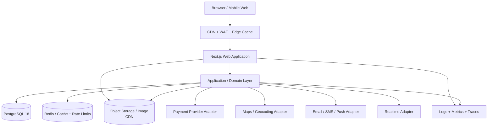
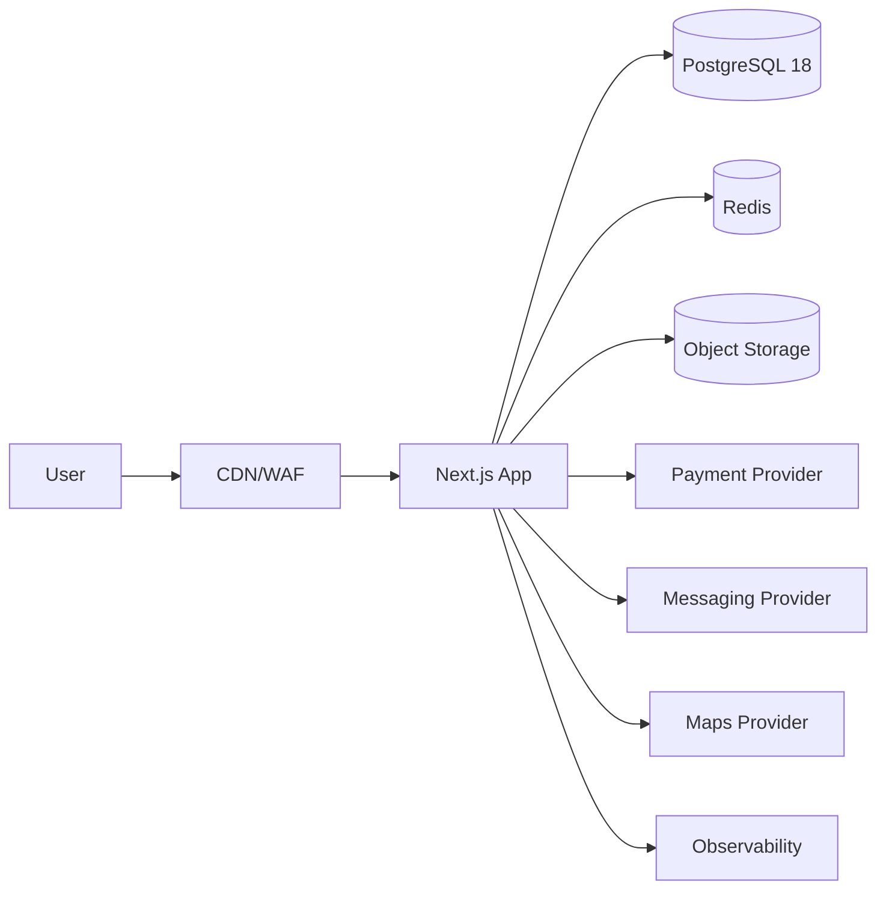

# Architecture & Design — Premium Fast-Food Ordering + Brand Website

**Document ID:** FF-ARCH-001  
**Version:** 1.0  
**Status:** Implementation Baseline  
**Architecture style:** Modular monolith with strong domain boundaries  
**Primary runtime:** Next.js 16.x / React 19.x / Node.js 20.9+ baseline

## 1. Architectural Decision

Use a **modular monolith** for the first production system.

This is deliberate. A restaurant commerce product has several tightly coupled transactions—menu availability, pricing, modifiers, delivery qualification, promotion evaluation, payment confirmation, and order creation. Splitting these into microservices too early would increase deployment, observability, network, consistency, and testing complexity without a demonstrated need.

The application should behave as separate bounded modules inside one deployable system. Each module owns its business rules and persistence boundary. Integration contracts are explicit so a high-volume module can later be extracted without redesigning the entire product.

## 2. High-Level Architecture



## 3. Frontend Architecture

Use Next.js App Router.

Next.js describes itself as a full-stack React framework, and Next.js 16 includes stable Turbopack, optimized routing/prefetching, Cache Components/PPR, React Compiler integration, and React 19.2. citeturn513476search0turn513476search2

### 3.1 Rendering policy

| Content | Rendering strategy |
|---|---|
| Home/menu shell | Server-first, cached where safe |
| Menu category data | Cached with tag-based invalidation |
| Product details | Server-rendered with selective client interactivity |
| Cart drawer | Client state + server validation |
| Checkout | Dynamic server boundary |
| Order tracking | Dynamic/realtime client surface |
| About page | Server-rendered narrative shell + client motion/3D islands |
| Admin | Dynamic authenticated routes |
| Legal pages | Static/cached |

Next.js 16's `use cache`, `cacheLife`, and tag-based invalidation provide a good fit for menu/content data that changes much less frequently than it is read. citeturn446940search0turn446940search7

### 3.2 Frontend module boundaries

```text
src/
  app/
    (storefront)/
    (account)/
    (checkout)/
    (brand)/
    admin/
    api/
  features/
    menu/
    cart/
    checkout/
    ordering/
    account/
    promotions/
    branches/
    tracking/
    brand-content/
  components/
    ui/
    commerce/
    motion/
    three/
  lib/
    auth/
    db/
    cache/
    observability/
    validation/
    security/
  server/
    domains/
      catalog/
      pricing/
      promotions/
      orders/
      delivery/
      payments/
      branches/
      content/
      customers/
```

Do not allow UI components to contain business logic for pricing, promotions, delivery fees, or authorization.

## 4. Domain Modules

### Catalog

Owns categories, products, images, modifiers, availability rules, tags.

### Pricing

Owns authoritative item prices, modifier price deltas, pricing snapshots, tax/fee rules.

### Promotions

Owns coupon and campaign rules, eligibility, redemption limits, and discount calculation.

### Ordering

Owns cart validation, order creation, line-item snapshots, order state machine, cancellations, refunds, and order events.

### Delivery

Owns branches, delivery zones, serviceability, estimated delivery windows, and delivery fee calculation.

### Payments

Owns payment intent creation, provider callbacks/webhooks, payment reconciliation, and status mapping. It must not own card data.

### Customers

Owns user identity, addresses, preferences, order history access, and consent records.

### Content

Owns About/brand pages, hero sections, gallery, campaign pages, SEO metadata, FAQs, and publication state.

### Operations

Owns staff users, order queue, overrides, branch configuration, audit logs.

## 5. Transaction Boundaries

### Place-order transaction

1. Load active branch/menu version.
2. Validate each product.
3. Validate modifiers.
4. Validate serviceability.
5. Validate promotion/coupon.
6. Calculate authoritative totals.
7. Create order + immutable line-item snapshots.
8. Create payment intent if required.
9. Commit transaction.
10. Emit an outbox event.

The order must not depend on client-calculated totals.

### Payment callback transaction

1. Authenticate/verify provider webhook.
2. Resolve provider event id.
3. Check idempotency record.
4. Update payment status.
5. Transition order if the mapped payment state is authoritative.
6. Write audit/event record.
7. Commit.
8. Return provider-expected success response.

## 6. Eventing

Use a transactional outbox table in PostgreSQL for important domain events.

Examples:

- `order.created`
- `order.confirmed`
- `order.status_changed`
- `payment.succeeded`
- `payment.failed`
- `promotion.redeemed`
- `menu.updated`
- `branch.updated`

A simple worker can publish/send notifications. This can later be replaced by a managed queue without changing domain code.

## 7. Caching Strategy

### Cache aggressively

- categories
- menu items
- branch public metadata
- About content
- FAQs
- promotional content that is safe to cache
- optimized images

### Do not blindly cache

- cart state
- payment state
- account data
- authorization decisions
- inventory/availability that changes second-by-second unless explicitly designed
- personalized order information

Cloudflare's current cache documentation supports global edge caching, cache rules, and tiered caching; image optimization can dynamically generate transformed image variants. citeturn928003search6turn928003search16

## 8. 3D/Motion Architecture

3D is implemented as an isolated client-side capability.

Recommended stack:

- Three.js
- React Three Fiber
- Drei where appropriate
- GSAP + ScrollTrigger for narrative timelines

React Three Fiber is a React renderer for three.js. Its documentation explicitly warns that creating geometry/materials is expensive, recommends reuse, and recommends on-demand rendering when continuous animation is unnecessary. citeturn905846search1turn905846search15

### 3D rules

- The store/menu experience must work without 3D.
- About-page 3D must lazy-load.
- Use GLTF/GLB assets with compressed textures.
- Reuse geometry/material instances.
- Dispose unused GPU resources.
- Prefer on-demand rendering for non-continuous scenes.
- Provide a static/video/image fallback.
- Respect `prefers-reduced-motion`.
- Detect low-power/mobile conditions and lower quality automatically.

Three.js documentation emphasizes that GPU-backed geometries/materials are not automatically released and must be disposed correctly; this is a production requirement, not an optimization afterthought. citeturn905846search8

## 9. API Design

Use a versioned, typed HTTP API through Next.js Route Handlers/server actions where suitable. Keep business/domain services independent from transport.

Example external endpoints:

```text
GET    /api/v1/menu
GET    /api/v1/menu/categories
GET    /api/v1/products/:slug
POST   /api/v1/cart/validate
POST   /api/v1/orders
GET    /api/v1/orders/:id
POST   /api/v1/orders/:id/cancel
GET    /api/v1/orders/:id/events
POST   /api/v1/payments/intents
POST   /api/v1/payments/webhooks/:provider
GET    /api/v1/branches
POST   /api/v1/delivery/quote
POST   /api/v1/auth/login
POST   /api/v1/auth/logout
POST   /api/v1/support/tickets
```

Admin endpoints must be isolated by authorization scope.

## 10. Authorization Model

Roles:

- `CUSTOMER`
- `STAFF`
- `KITCHEN_OPERATOR`
- `BRANCH_MANAGER`
- `CONTENT_MANAGER`
- `ADMIN`
- `SUPER_ADMIN`

Authorization must be checked at both function and object level. OWASP identifies broken object-level authorization and broken function-level authorization as major API risks. citeturn928003search3

## 11. Error Architecture

Errors use stable machine-readable codes, not only human strings.

Example:

```json
{
  "error": {
    "code": "DELIVERY_NOT_SERVICEABLE",
    "message": "This address is outside the delivery area.",
    "requestId": "req_123"
  }
}
```

Never leak SQL errors, stack traces, payment secrets, or internal identifiers to customers.

## 12. Observability Architecture

Every request receives a correlation/request id.

Capture:

- route latency
- database latency
- payment latency
- checkout failure rate
- webhook failure rate
- order-state transition events
- cache hit/miss where material
- frontend runtime errors
- JavaScript chunk failures
- 3D load failure rate
- Core Web Vitals

Use structured JSON logs and OpenTelemetry-compatible tracing.

## 13. Deployment Architecture

Recommended production topology:



Use managed services for database, cache, object storage, and monitoring where economically sensible. Do not self-host commodity infrastructure merely for ideological control.

## 14. Architecture Fitness Checks

Before extracting any module into a separate service, require measured evidence such as:

- independent scaling need
- independent deployment cadence
- resource isolation requirement
- queue/backpressure need
- organizational ownership boundary
- failure containment need

Without one of these, keep the module inside the monolith.

## 15. Research Basis

- Next.js 16 introduced Cache Components/PPR, stable Turbopack, improved routing/prefetching, and React 19.2 integration. citeturn513476search0turn513476search2
- Next.js 16's caching documentation recommends precise tag-based invalidation when possible. citeturn446940search0
- PostgreSQL 18 is currently supported and recommended on its current minor release line. citeturn569372search5
- React Three Fiber provides reusable three.js components but documents specific performance pitfalls around object creation, rendering loops, and asset reuse. citeturn905846search1turn905846search15
- GSAP ScrollTrigger supports scrub/pin/snap and viewport-driven animation. citeturn928003search8
- Cloudflare provides globally distributed caching and image optimization suitable for media-heavy sites. citeturn928003search6turn928003search16
