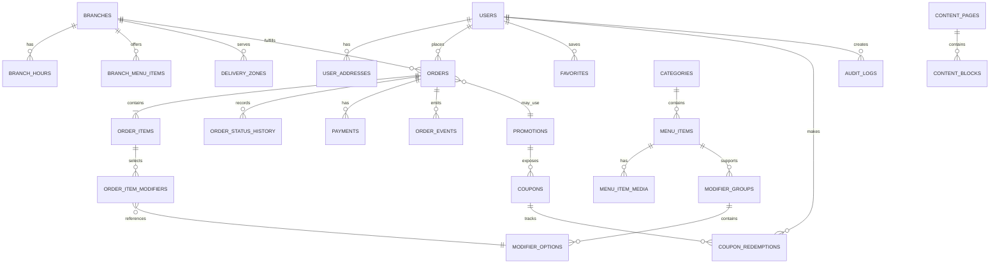

# Backend Schema — Premium Fast-Food Ordering System

**Document ID:** FF-DB-001  
**Version:** 1.0  
**Database:** PostgreSQL 18.x  
**ORM:** Drizzle ORM recommended  
**Schema style:** relational, normalized core + immutable order snapshots

## 1. Database Principles

- PostgreSQL is the system of record.
- Use UUID or UUIDv7-compatible identifiers for externally exposed entities.
- Use `timestamptz` for timestamps.
- Store money as integer minor units plus explicit currency code; never use floating-point money.
- Use database constraints for fundamental invariants.
- Use soft deletion only where historical references require it; do not soft-delete financial records into ambiguity.
- Preserve immutable order snapshots so later menu edits cannot rewrite historical orders.
- Keep payment-provider payloads in a dedicated table with sensitive data minimized/redacted.
- Every admin mutation that changes business behavior must be auditable.

PostgreSQL 18 is the current supported major release and PostgreSQL's versioning guidance recommends staying on the current minor release within the supported major line. citeturn569372search5turn569372search10

Drizzle provides native PostgreSQL support and can operate with `node-postgres` or `postgres.js`. citeturn928003search13

## 2. Entity Relationship Map



## 3. Core Tables

### 3.1 `users`

```text
id uuid PK
email citext UNIQUE NULLABLE
phone varchar UNIQUE NULLABLE
password_hash text NULLABLE
first_name varchar
last_name varchar
status user_status NOT NULL DEFAULT 'ACTIVE'
email_verified_at timestamptz NULL
phone_verified_at timestamptz NULL
created_at timestamptz NOT NULL
updated_at timestamptz NOT NULL
last_login_at timestamptz NULL
```

Do not store plaintext passwords. Consider passwordless/OTP authentication as an adapter rather than coupling the domain to one method.

### 3.2 `user_roles`

```text
user_id uuid FK users.id
role role_enum
PRIMARY KEY (user_id, role)
```

### 3.3 `user_addresses`

```text
id uuid PK
user_id uuid FK users.id
label varchar
recipient_name varchar
phone varchar
address_line_1 text
address_line_2 text NULL
city varchar
postal_code varchar NULL
authority_area varchar NULL
latitude numeric(9,6) NULL
longitude numeric(9,6) NULL
instructions text NULL
is_default boolean DEFAULT false
created_at timestamptz
updated_at timestamptz
```

Do not assume client-supplied coordinates are authoritative. Revalidate/normalize location data before serviceability decisions.

## 4. Restaurant/Branch Tables

### `branches`

```text
id uuid PK
slug varchar UNIQUE
name varchar
phone varchar
email varchar NULL
address_line_1 text
address_line_2 text NULL
city varchar
postal_code varchar NULL
latitude numeric(9,6) NULL
longitude numeric(9,6) NULL
status branch_status NOT NULL
accepts_delivery boolean NOT NULL
accepts_pickup boolean NOT NULL
created_at timestamptz
updated_at timestamptz
```

Remove the accidental space in `accepts_*` during implementation; intended fields are `accepts_delivery` and `accepts_pickup`.

### `branch_hours`

```text
id uuid PK
branch_id uuid FK branches.id
day_of_week smallint CHECK (day_of_week BETWEEN 0 AND 6)
open_time time NULL
close_time time NULL
is_closed boolean DEFAULT false
```

### `branch_exceptions`

```text
id uuid PK
branch_id uuid FK branches.id
service_date date
is_closed boolean
open_time time NULL
close_time time NULL
reason text NULL
```

### `delivery_zones`

```text
id uuid PK
branch_id uuid FK branches.id
name varchar
rule_type delivery_rule_type
max_distance_m integer NULL
polygon_geojson jsonb NULL
base_fee_minor integer
per_km_fee_minor integer NULL
minimum_order_minor integer DEFAULT 0
estimated_minutes_min smallint
estimated_minutes_max smallint
active boolean DEFAULT true
```

A later spatial implementation can replace JSON polygon storage with PostGIS if serviceability complexity or scale warrants it.

## 5. Catalog Tables

### `categories`

```text
id uuid PK
slug varchar UNIQUE
name varchar
description text NULL
image_media_id uuid NULL
sort_order integer
active boolean
seo_title varchar NULL
seo_description text NULL
created_at timestamptz
updated_at timestamptz
```

### `menu_items`

```text
id uuid PK
slug varchar UNIQUE
name varchar
description text NULL
base_price_minor integer
currency char(3)
category_id uuid FK categories.id
status menu_item_status
is_featured boolean DEFAULT false
sort_order integer
sku varchar UNIQUE NULL
allergen_info jsonb NULL
tags text[] NULL
created_at timestamptz
updated_at timestamptz
```

### `menu_item_media`

```text
id uuid PK
menu_item_id uuid FK menu_items.id
media_type media_type
url text
alt_text text
width integer
height integer
sort_order integer
```

### `modifier_groups`

```text
id uuid PK
menu_item_id uuid FK menu_items.id
name varchar
selection_type modifier_selection_type
min_selections smallint
max_selections smallint
sort_order integer
required boolean
```

### `modifier_options`

```text
id uuid PK
modifier_group_id uuid FK modifier_groups.id
name varchar
price_delta_minor integer
sku varchar NULL
active boolean
sort_order integer
```

### `branch_menu_items`

This table controls branch-specific availability/price overrides.

```text
branch_id uuid FK branches.id
menu_item_id uuid FK menu_items.id
active boolean
price_override_minor integer NULL
available_from timestamptz NULL
available_until timestamptz NULL
PRIMARY KEY (branch_id, menu_item_id)
```

## 6. Promotion Tables

### `promotions`

```text
id uuid PK
name varchar
code varchar UNIQUE NULL
promotion_type promotion_type
starts_at timestamptz
ends_at timestamptz
status promotion_status
priority integer
stackable boolean
conditions jsonb
benefit jsonb
usage_limit_total integer NULL
usage_limit_per_user integer NULL
created_at timestamptz
updated_at timestamptz
```

The domain service must validate promotions against authoritative catalog and order data rather than trusting the JSON blob alone.

### `coupon_redemptions`

```text
id uuid PK
promotion_id uuid FK promotions.id
coupon_code varchar
user_id uuid NULL FK users.id
order_id uuid FK orders.id
redeemed_at timestamptz
unique_key varchar UNIQUE
```

## 7. Order Tables

### `orders`

```text
id uuid PK
order_number varchar UNIQUE
user_id uuid NULL FK users.id
branch_id uuid FK branches.id
service_mode service_mode
status order_status
currency char(3)
subtotal_minor integer
discount_minor integer
delivery_fee_minor integer
tax_minor integer
service_fee_minor integer
total_minor integer
customer_name varchar
customer_phone varchar
customer_email varchar NULL
delivery_address_snapshot jsonb NULL
special_instructions text NULL
coupon_code varchar NULL
idempotency_key varchar UNIQUE
placed_at timestamptz NULL
confirmed_at timestamptz NULL
delivered_at timestamptz NULL
cancelled_at timestamptz NULL
created_at timestamptz
updated_at timestamptz
```

### `order_items`

Immutable snapshot fields are required.

```text
id uuid PK
order_id uuid FK orders.id
menu_item_id uuid NULL FK menu_items.id
item_name_snapshot varchar
unit_price_minor integer
quantity integer CHECK (quantity > 0)
line_total_minor integer
notes text NULL
metadata jsonb NULL
```

### `order_item_modifiers`

```text
id uuid PK
order_item_id uuid FK order_items.id
modifier_option_id uuid NULL FK modifier_options.id
name_snapshot varchar
price_delta_minor integer
quantity integer DEFAULT 1
```

### `order_status_history`

```text
id uuid PK
order_id uuid FK orders.id
from_status order_status NULL
to_status order_status
changed_by_user_id uuid NULL FK users.id
reason text NULL
created_at timestamptz
```

### `order_events`

```text
id uuid PK
order_id uuid FK orders.id
event_type varchar
payload jsonb
created_at timestamptz
published_at timestamptz NULL
attempts integer DEFAULT 0
last_error text NULL
```

## 8. Payment Tables

### `payments`

```text
id uuid PK
order_id uuid FK orders.id
provider varchar
provider_payment_id varchar
amount_minor integer
currency char(3)
status payment_status
method_type varchar NULL
failure_code varchar NULL
created_at timestamptz
updated_at timestamptz
UNIQUE (provider, provider_payment_id)
```

### `payment_events`

```text
id uuid PK
provider varchar
provider_event_id varchar
payment_id uuid NULL FK payments.id
signature_verified boolean
payload_redacted jsonb
received_at timestamptz
processed_at timestamptz NULL
processing_status varchar
UNIQUE (provider, provider_event_id)
```

## 9. Content Tables

### `content_pages`

```text
id uuid PK
slug varchar UNIQUE
page_type varchar
status content_status
seo_title varchar NULL
seo_description varchar NULL
published_at timestamptz NULL
created_at timestamptz
updated_at timestamptz
```

### `content_blocks`

```text
id uuid PK
page_id uuid FK content_pages.id
block_type varchar
sort_order integer
content jsonb
published boolean
```

Supported first-release block types:

- `hero`
- `story_split`
- `ingredient_story`
- `timeline`
- `gallery`
- `3d_scene`
- `quote`
- `branch_cta`
- `order_cta`
- `faq`

## 10. Support / Audit Tables

### `support_tickets`

```text
id uuid PK
user_id uuid NULL FK users.id
order_id uuid NULL FK orders.id
category varchar
subject varchar
message text
status support_status
created_at timestamptz
updated_at timestamptz
```

### `audit_logs`

```text
id uuid PK
actor_user_id uuid NULL FK users.id
action varchar
entity_type varchar
entity_id uuid NULL
before_data jsonb NULL
after_data jsonb NULL
request_id varchar NULL
ip_hash varchar NULL
created_at timestamptz
```

Never write credentials, full payment secrets, raw tokens, or unnecessary personal data into audit records.

## 11. Important Indexes

Minimum indexing plan:

```text
users(email)
users(phone)
menu_items(slug)
menu_items(category_id, active, sort_order)
branch_menu_items(branch_id, active)
orders(order_number)
orders(user_id, created_at DESC)
orders(branch_id, status, created_at)
order_status_history(order_id, created_at)
payments(order_id)
payment_events(provider, provider_event_id)
promotions(code)
content_pages(slug, status)
audit_logs(entity_type, entity_id, created_at)
```

Add indexes only after validating query patterns; avoid indiscriminate indexing of every column.

## 12. Data Integrity Rules

- `total_minor = subtotal_minor - discount_minor + delivery_fee_minor + tax_minor + service_fee_minor` after all adjustments.
- `line_total_minor` equals unit price + modifier deltas multiplied by quantity.
- Order item names/prices are snapshots.
- Payment amount must match the authoritative order amount for the payment attempt.
- A single provider event id is processed at most once.
- One idempotency key maps to one order creation attempt/result.
- Status transitions must follow a server-defined state machine.
- Coupon redemption records are unique for the applicable business constraint.

## 13. Recommended PostgreSQL Extensions/Features

Use only when justified:

- `citext` for case-insensitive email behavior.
- `pgcrypto` for UUID/randomness where appropriate.
- PostGIS later if delivery zones require spatial querying beyond simple rules.

## 14. Migration Strategy

- Every schema change is migration-first.
- Production migrations must be backward-compatible when rollout requires multiple application versions.
- Never drop a column in the same deployment that removes all application reads unless the deployment strategy guarantees atomic replacement.
- Seed data must be deterministic and safe to rerun.
- Production data fixes require explicit migration scripts, not ad-hoc manual SQL.
