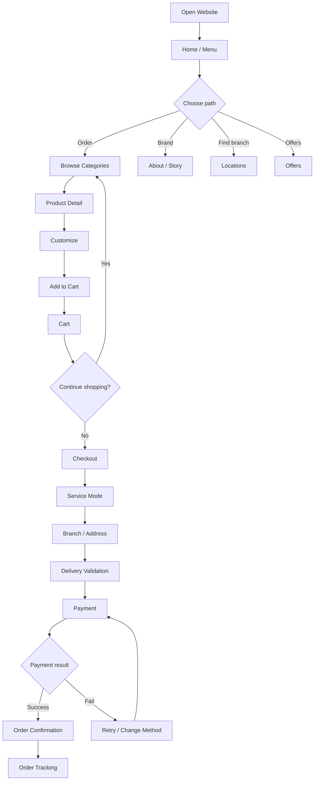
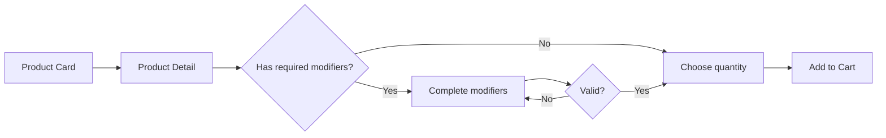
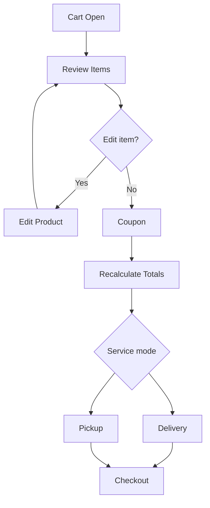
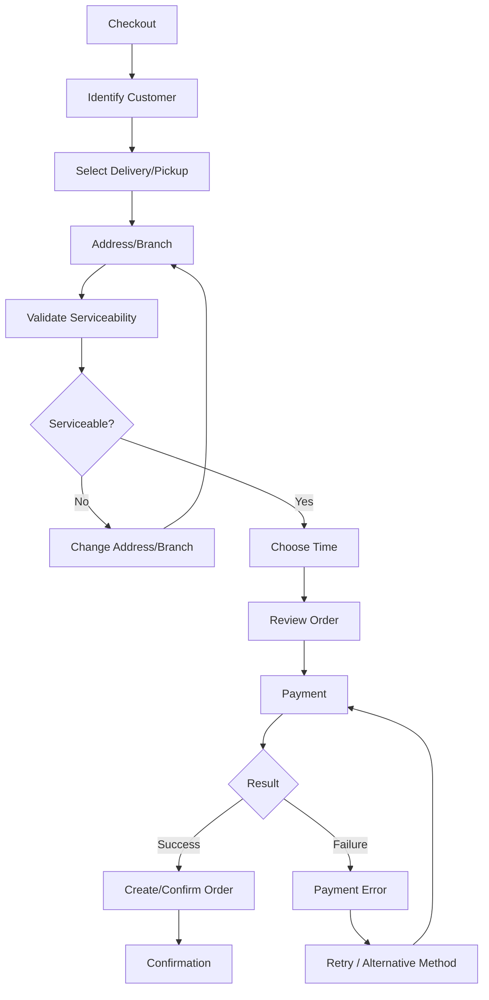
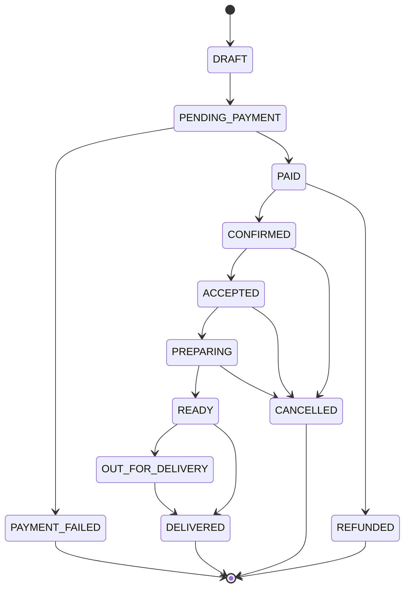
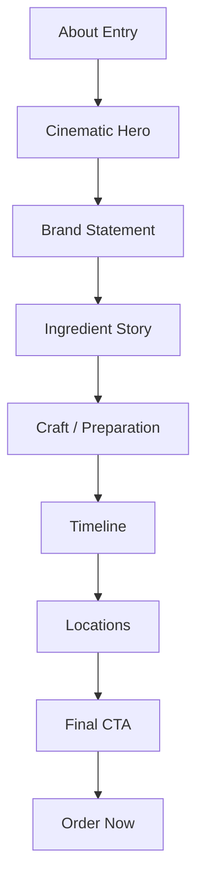
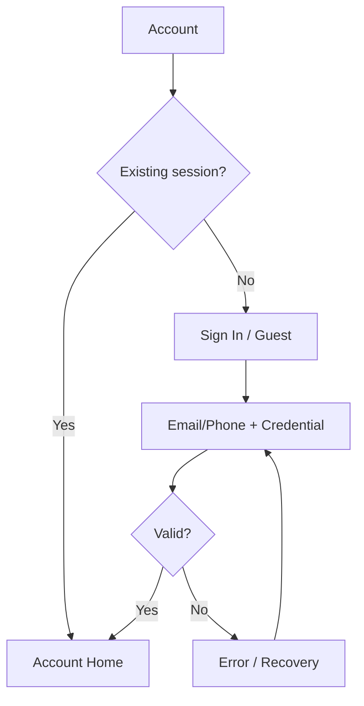
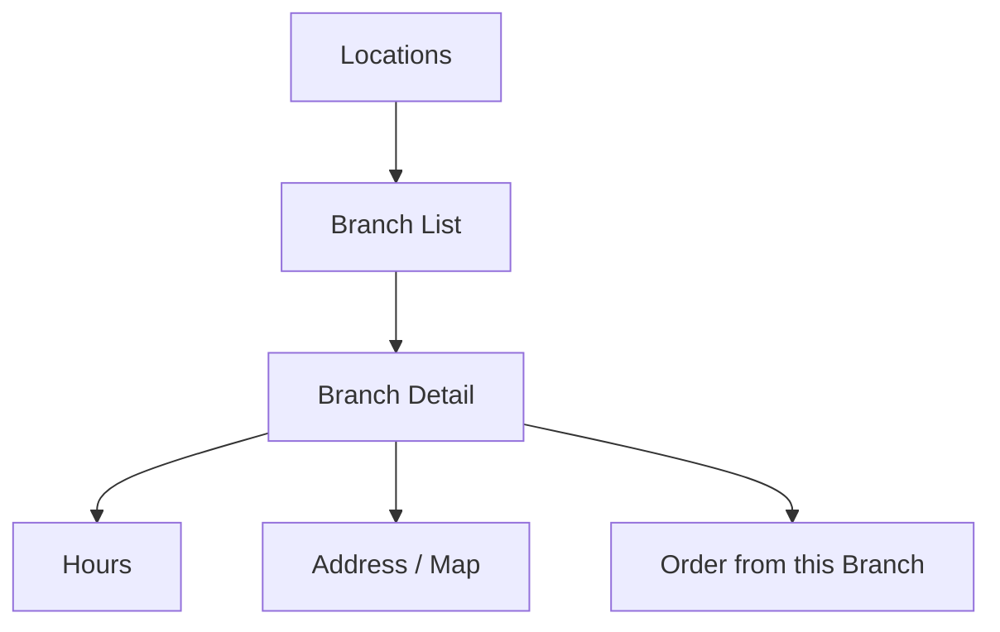
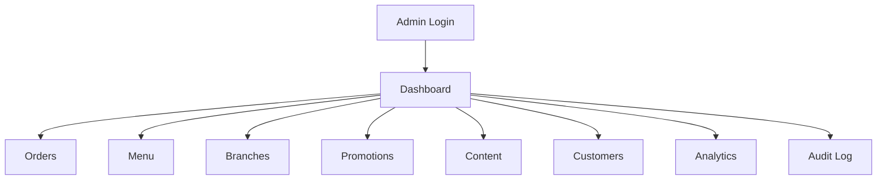
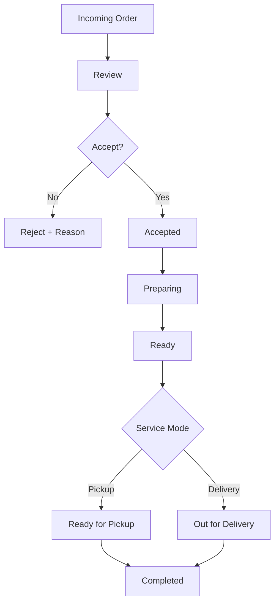

# App Flow — Customer, Brand, Checkout & Operations

**Document ID:** FF-FLOW-001  
**Version:** 1.0  
**Status:** Interaction Baseline

## 1. Global Customer Flow



## 2. Home/Menu Flow

### Step 1 — Arrival

The user sees branded food imagery and immediately understands the restaurant and the ordering action.

### Step 2 — Service location

If pricing/availability depends on location, request branch/address early enough to avoid showing invalid products while preserving a quick browse option where possible.

### Step 3 — Browse

Use category navigation and featured promotions.

### Step 4 — Select

Click/tap a product card.

### Step 5 — Customize

Display required modifier groups first, then optional groups.

### Step 6 — Add

CTA shows resulting total. Cart count updates immediately.

## 3. Product Flow



## 4. Cart Flow



## 5. Checkout Flow



## 6. Order State Flow



Actual permitted transitions should be implemented in a domain state machine rather than inferred from arbitrary UI buttons.

## 7. About / Brand Story Flow



The narrative should gradually increase emotional commitment while allowing users to jump to ordering.

## 8. Authentication Flow



Guest checkout should remain available unless explicitly removed by business policy.

## 9. Reorder Flow

```text
Account → Orders → Select Previous Order → Revalidate Current Menu → Revalidate Modifiers/Availability → Add Valid Items → Cart → Checkout
```

A reorder is a fresh order attempt, not a copy of the old order state.

## 10. Location Flow



Branch information must come from the authoritative branch model so operational closures are reflected consistently.

## 11. Admin Flow



## 12. Admin Order Flow



Every staff status change is recorded in `order_status_history` and should also generate an order event when customer communication depends on it.

## 13. Failure Flows

### Payment failure

Never create an extra order merely because the customer retries payment.

### Network timeout during order creation

The client retries using the same idempotency key and retrieves the existing result.

### Menu item becomes unavailable after cart creation

Checkout revalidates and clearly identifies the changed item instead of silently changing the customer's selection.

### Branch closes while checkout is open

Server validation blocks order creation and offers another branch/service mode where appropriate.

### Realtime connection lost

Tracking falls back to periodic refresh/polling.

### 3D asset failure

Show static image or simplified scene; ordering continues.

## 14. SEO/Discovery Flow

Search engines should primarily discover:

- Home/menu
- category pages where indexable
- location pages
- About/brand pages
- promotional landing pages
- FAQ/legal pages where appropriate

Private/order/account routes must not become the principal SEO surface.
